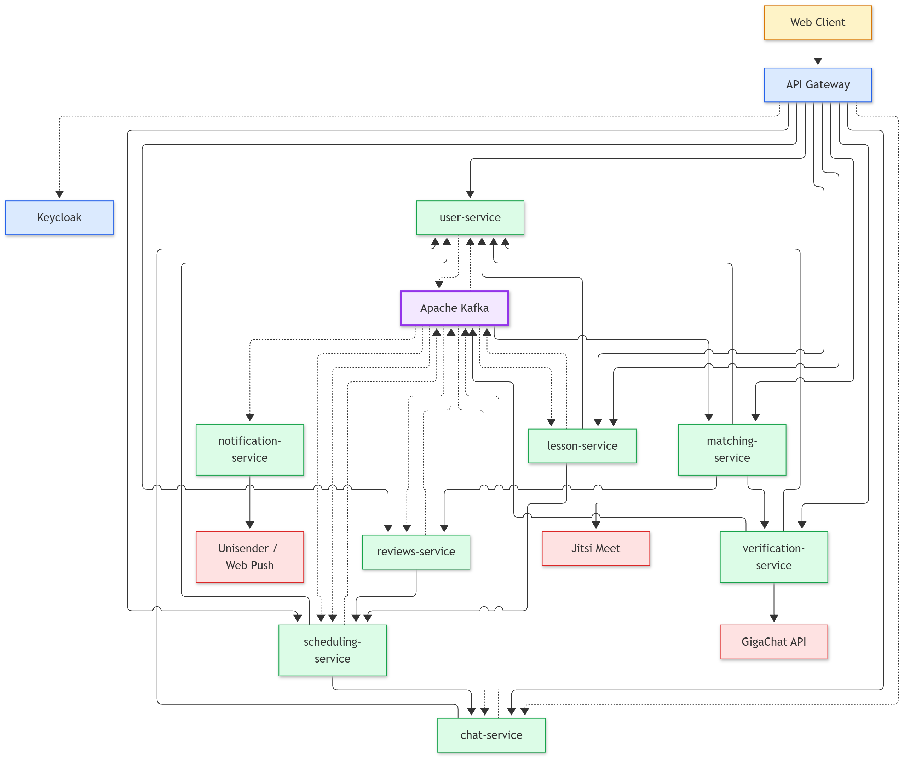
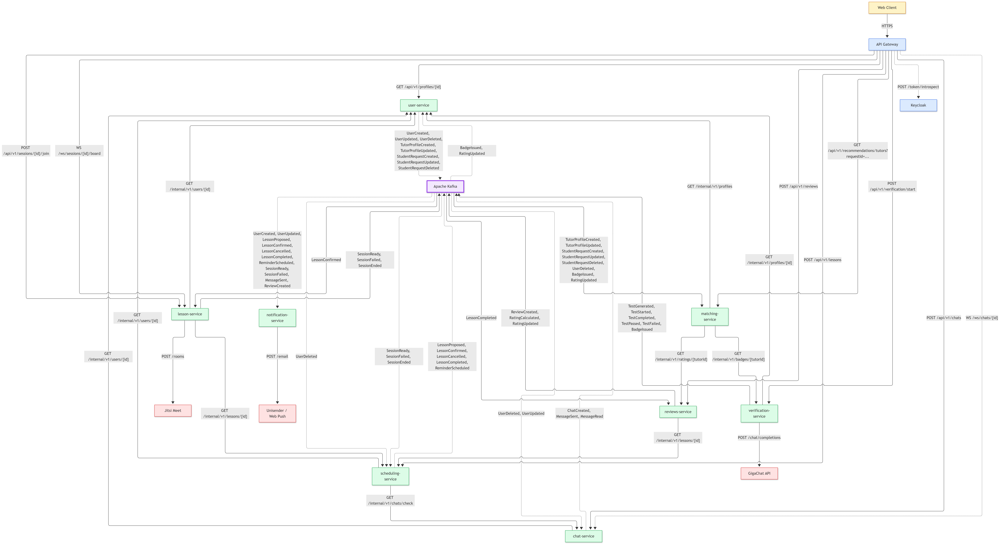
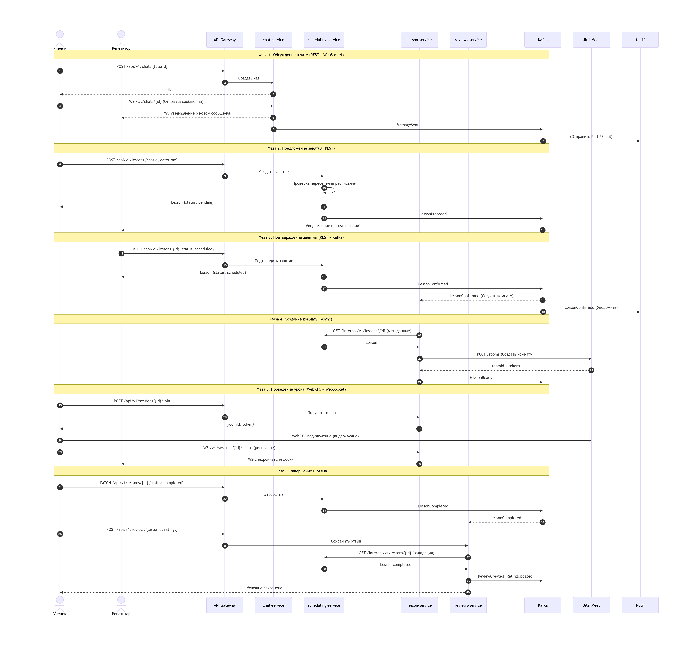
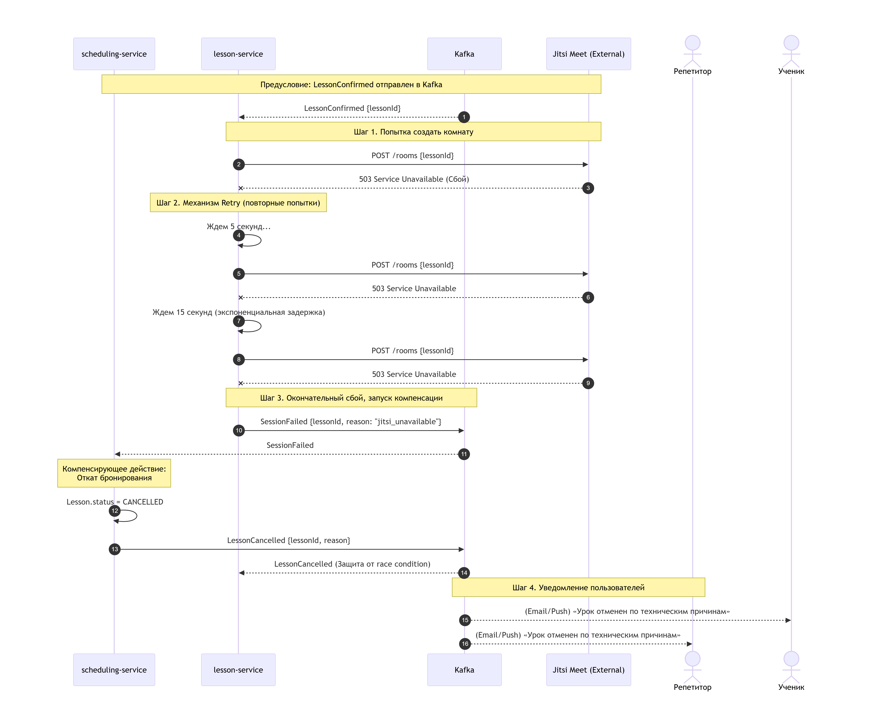

**1\. Описание системы**

Веб-платформа представляет собой двусторонний маркетплейс для репетиторов и учеников. Обе стороны заполняют анкеты (репетитор) или заявки (ученик) с категориями и текстовым описанием. На основе семантического анализа текстов рекомендательная система подбирает наиболее совместимые пары. Платформа включает верификацию навыков репетиторов через AI-генерируемые тесты, встроенный чат, систему отзывов, календарь занятий и возможность проведения видеоуроков с интерактивной доской. Система автоматизирует полный цикл: от поиска до проведения занятия.

---

**2\. Акторы**

Пользовательские роли:

| Актор | Описание |
| :---: | :---: |
| Ученик (Student) | Пользователь, ищущий репетитора. Создаёт заявки, просматривает рекомендации, общается в чате, записывается на занятия, оставляет отзывы. |
| Репетитор (Tutor) | Пользователь, предлагающий услуги. Заполняет анкету, проходит верификацию, ищет учеников, проводит занятия, получает отзывы. |

Внешние системы:

| Внешняя система | Назначение | Взаимодействие |
| :---: | :---: | :---: |
| LLM API (GigaChat) | Генерация и проверка тестов для верификации навыков | Синхронные REST-запросы |
| Video Service (Jitsi) | Проведение видеоуроков в реальном времени | Синхронные REST-запросы \+ WebRTC |
| Notification Service (Email / Web-Push) | Отправка напоминаний о занятиях и уведомлений | Асинхронные события |

---

**3\. Пользовательские сценарии**

| ID | Сценарий |
| :---: | :---: |
| ST-01 | Как ученик, я хочу зарегистрироваться, чтобы получить доступ к поиску репетиторов. |
| ST-02 | Как ученик, я хочу заполнить заявку (предмет, уровень, цель, бюджет, текст), чтобы система подобрала мне репетиторов. |
| ST-03 | Как ученик, я хочу создать несколько заявок для разных предметов, чтобы искать репетиторов по каждому направлению отдельно. |
| ST-04 | Как ученик, я хочу видеть ранжированный список репетиторов с процентами совместимости, чтобы выбрать лучшего. |
| ST-05 | Как ученик, я хочу написать репетитору в чат до записи, чтобы обсудить детали. |
| ST-06 | Как ученик, я хочу записаться на занятие (выбрать дату и время), чтобы начать обучение. |
| ST-07 | Как ученик, я хочу провести видеоурок с интерактивной доской, чтобы заниматься онлайн. |
| ST-08 | Как ученик, я хочу оставить развёрнутый отзыв по критериям после занятия, чтобы помочь другим. |
| TT-01 | Как репетитор, я хочу зарегистрироваться, чтобы найти учеников. |
| TT-02 | Как репетитор, я хочу заполнить анкету (опыт, методика, цена, текст), чтобы система подобрала мне учеников. |
| TT-03 | Как репетитор, я хочу пройти верификацию навыков (AI-тест), чтобы получить бейдж и повысить доверие. |
| TT-04 | Как репетитор, я хочу видеть ранжированный список учеников (по их заявкам), чтобы выбрать подходящих. |
| TT-05 | Как репетитор, я хочу предложить занятие (выбрать дату и время), чтобы начать работу. |
| TT-06 | Как репетитор, я хочу провести видеоурок с интерактивной доской. |

---

**4\. Доменные события**  
Доменные события сформулированы в прошедшем времени. Они сгруппированы по логическим блокам.  
**Пользователи и профили:**

* UserCreated  
* UserUpdated  
* UserDeleted  
* TutorProfileCreated  
* TutorProfileUpdated  
* StudentRequestCreated  
* StudentRequestUpdated  
* StudentRequestDeleted

**Верификация:**

* TestGenerated  
* TestStarted  
* TestCompleted  
* TestPassed  
* TestFailed  
* BadgeIssued

**Рекомендации и подбор:**

* RecommendationsRequested  
* RecommendationsGenerated  
* CompatibilityCalculated

**Коммуникация:**

* ChatCreated  
* MessageSent  
* MessageRead

**Занятия:**

* LessonProposed  
* LessonConfirmed  
* LessonRejected  
* LessonStarted  
* LessonCompleted  
* LessonCancelled  
* ReminderSent

**Отзывы и рейтинг:**

* ReviewCreated  
* RatingCalculated  
* RatingUpdated

---

**5\. Ограниченные контексты и глоссарии**  
На основе доменных событий и сущностей выделяем 7 ограниченных контекстов.  
---

**Контекст 1: Profile & Request Management (Анкеты и заявки)**  
**Ответственность:** создание, редактирование и хранение анкет репетиторов и заявок учеников, векторизация текстов.  
**Глоссарий:**

| Термин | Значение в контексте |
| :---: | :---: |
| Анкета | Профиль репетитора: категории (предмет, цена, формат) \+ текстовое описание. |
| Заявка | Профиль ученика: категории (предмет, уровень, цель, бюджет) \+ текстовое описание. |
| Эмбеддинг | Векторное представление текста (384 числа), полученное через SBERT. |
| Категория | Структурированный параметр анкеты/заявки (предмет, цена, уровень и т.д.). |
| Активность | Флаг, показывающий, что заявка/анкета доступна для поиска. |

**События**: UserCreated, UserUpdated, UserDeleted, TutorProfileCreated, TutorProfileUpdated, StudentRequestCreated, StudentRequestUpdated, StudentRequestDeleted. 

---

**Контекст 2: Verification (Верификация навыков)**  
**Ответственность:** генерация тестов через LLM, проведение тестирования, проверка ответов, выдача бейджей.  
**Глоссарий:**

| Термин | Значение в контексте |
| :---: | :---: |
| Тест | Набор вопросов, сгенерированных LLM для конкретного предмета. |
| Результат | Балл, полученный репетитором за прохождение теста. |
| Порог | Минимальный балл для успешной верификации (например, 70). |
| Бейдж | Визуальная отметка в профиле репетитора о пройденной верификации. |
| Пересдача | Повторное прохождение теста после неудачи (доступно через 24 часа). |

**События:** TestGenerated, TestStarted, TestCompleted, TestPassed, TestFailed, BadgeIssued.  

---

**Контекст 3: Matching & Recommendations (Подбор и рекомендации)**  
**Ответственность:** семантический поиск, расчёт косинусной близости, ранжирование, выдача рекомендаций.  
**Глоссарий:**

| Термин | Значение в контексте |
| ----- | ----- |
| Совместимость | Косинусная близость между эмбеддингами анкеты и заявки (0–1). |
| Рейтинг | Итоговый скор для сортировки: 0.5×совместимость \+ 0.3×отзывы \+ 0.15×верификация \+ 0.05×буст. |
| Буст новичка | Временный приоритет для репетиторов, зарегистрированных менее 14 дней назад. |
| Жёсткие фильтры | Отсев по категориям (предмет, цена, формат, расписание) до ранжирования. |
| Рекомендация | Ранжированный список анкет/заявок, отсортированный по рейтингу. |

**События:** RecommendationsRequested, RecommendationsGenerated, CompatibilityCalculated.  

---

**Контекст 4: Communication (Чат)**  
**Ответственность:** обмен сообщениями между пользователями, управление чатами, защита от спама.  
**Глоссарий:**

| Термин | Значение в контексте |
| :---: | :---: |
| Чат | Диалог между парой пользователей (ученик ↔ репетитор). |
| Сообщение | Текстовая реплика в чате. |
| Лимит | Ограничение на количество новых диалогов в день (5 для ученика, 10 для репетитора). |
| Жалоба | Сигнал о спаме или нарушении. |
| Непрочитанное | Сообщение, которое получатель ещё не открыл. |

**События:** ChatCreated, MessageSent, MessageRead.  

---

**Контекст 5: Scheduling & Lessons (Занятия)**  
**Ответственность:** управление расписанием, создание занятий, напоминания, проведение видеоуроков.  
**Глоссарий:**

| Термин | Значение в контексте |
| :---- | :---- |
| Занятие | Запланированный урок с датой, временем, статусом (pending, scheduled, completed, cancelled). |
| Слот расписания | Интервал доступности пользователя (день недели, время начала и конца). |
| Пересечение | Совпадение слотов ученика и репетитора, позволяющее назначить занятие. |
| Напоминание | Уведомление о предстоящем занятии (за 1 час). |
| Видео-комната | Виртуальное пространство для проведения урока. |

**События:** LessonProposed, LessonConfirmed, LessonRejected, LessonStarted, LessonCompleted, LessonCancelled, ReminderSent.  

---

**Контекст 6: Reviews & Ratings (Отзывы и рейтинг)**  
**Ответственность:** сбор отзывов и оценок по критериям после завершения занятия, расчёт и обновление среднего рейтинга репетитора.  
**Глоссарий:**

| Термин | Значение в контексте |
| :---- | :---- |
| Отзыв | Оценка репетитора учеником после проведённого занятия. |
| Критерий | Параметр оценки (например: качество объяснения, пунктуальность, коммуникация). |
| Оценка | Числовой балл (1–5) по каждому критерию. |
| Средний рейтинг | Агрегированный балл (от 0 до 5), рассчитываемый на основе всех отзывов. |
| Валидация | Проверка, что отзыв оставлен именно за завершённое занятие (LessonCompleted). |

**События:** ReviewCreated, RatingCalculated, RatingUpdated.

**2 Список и описание сервисов**

**Сервис 1: user-service**

| Поле | Значение |
| :---- | :---- |
| Название | user-service |
| Ответственность | Управление пользователями, анкетами репетиторов и заявками учеников. Векторизация текстов через SBERT для подбора. |
| Владеет данными | User, TutorProfile, StudentRequest, Embedding |
| **Предоставляет** | **Sync API:** GET /api/v1/profiles/{id}, POST /api/v1/profiles, POST /api/v1/requests, PATCH /api/v1/requests/{id}, GET /internal/v1/users/{id}, GET /internal/v1/profiles/{id}, GET /internal/v1/requests/{id}. **События:** UserCreated, UserUpdated, UserDeleted, TutorProfileCreated, TutorProfileUpdated, StudentRequestCreated, StudentRequestUpdated, StudentRequestDeleted. |
| **Зависит от** | **Sync:** — **Async:** подписан на BadgeIssued (от verification), RatingUpdated (от reviews). *(Примечание: регистрация через Keycloak происходит через вебхук или Gateway, Kafka здесь не используется)*. |
| Нефункциональные требования | Нагрузка: высокая (поиск профилей). Критичность: высокая. Задержка: \< 200 мс. Доступность: 99.9%. |
| Обоснование границы | 1\. Единый домен «пользователь и его профиль» — высокая связность. 2\. Собственная логика векторизации. 3\. Источник истины для профилей — другие сервисы только читают. |

---

**Сервис 2: verification-service**

| Поле | Значение |
| :---- | :---- |
| Название | verification-service |
| Ответственность | Генерация тестов через LLM, проведение тестирования, проверка ответов, выдача бейджей верификации. |
| Владеет данными | VerificationTest, Question, Answer, VerificationResult, Badge |
| **Предоставляет** | **Sync API:** POST /api/v1/verification/start, POST /api/v1/verification/submit, GET /internal/v1/badges/{tutorId}. **События:** TestGenerated, TestStarted, TestCompleted, TestPassed, TestFailed, BadgeIssued. |
| **Зависит от** | **Sync:** LLM API (GigaChat), user-service (GET /internal/v1/profiles/{id} — узнать предмет). **Async:** — |
| Нефункциональные требования | Нагрузка: низкая. Критичность: средняя. Задержка: \< 5 с (LLM). Доступность: 99%. |
| Обоснование границы | 1\. Core-домен — главная фишка доверия к платформе. 2\. Интеграция с внешним LLM API требует отдельного аудита. 3\. Собственная сложная логика (адаптивные тесты, пороги). |

---

**Сервис 3: matching-service**

| Поле | Значение |
| :---- | :---- |
| Название | matching-service |
| Ответственность | Семантический поиск, расчёт косинусной близости, ранжирование, выдача рекомендаций обеим сторонам. |
| Владеет данными | EmbeddingCache (Redis), RecommendationHistory (для аналитики) |
| **Предоставляет** | **Sync API:** GET /api/v1/recommendations/tutors, GET /api/v1/recommendations/requests. **События:** RecommendationsRequested, RecommendationsGenerated, CompatibilityCalculated. |
| **Зависит от** | **Sync:** user-service (профили), reviews-service (рейтинги), verification-service (бейджи). **Async:** подписан на TutorProfileCreated, UserDeleted, TutorProfileUpdated, StudentRequestCreated, StudentRequestUpdated, StudentRequestDeleted, BadgeIssued, RatingUpdated. |
| Нефункциональные требования | Нагрузка: очень высокая (главный эндпоинт). Критичность: высокая. Задержка: \< 500 мс. Доступность: 99.9%. |
| Обоснование границы | 1\. Core-домен — главная фишка проекта. 2\. Тяжёлые вычисления (косинусная близость) требуют отдельного кэша. 3\. Отдельные NFR (высокая нагрузка чтения). |

---

**Сервис 4: chat-service**

| Поле | Значение |
| :---- | :---- |
| Название | chat-service |
| Ответственность | Обмен сообщениями между пользователями через WebSocket, управление чатами, защита от спама. |
| Владеет данными | Chat, Message |
| **Предоставляет** | **Sync** API: POST /api/v1/chats, GET /api/v1/chats, GET /api/v1/chats/{id}/messages, GET /internal/v1/chats/check. WebSocket: /ws/chats/{id}. **События:** ChatCreated, MessageSent. |
| **Зависит от** | **Sync:** user-service (GET /internal/v1/users/{id} — данные собеседника). **Async:** UserDeleted, UserUpdated |
| Нефункциональные требования | Нагрузка: средняя. Критичность: средняя. Задержка: \< 100 мс (real-time). Доступность: 99.9%. |
| Обоснование границы | 1\. Real-time (WebSocket) — отдельный протокол. 2\. Собственная логика (лимиты, жалобы). 3\. Отличается от других сервисов по NFR. |

---

**Сервис 5: scheduling-service**

| Поле | Значение |
| :---- | :---- |
| Название | scheduling-service |
| Ответственность | Управление расписанием пользователей, создание и подтверждение занятий, публикация событий для напоминаний. |
| Владеет данными | AvailabilitySlot, Lesson (метаданные: время, статус, участники) |
| **Предоставляет** | **Sync API:** POST /api/v1/slots, POST /api/v1/lessons, PATCH /api/v1/lessons/{id}, GET /api/v1/lessons, GET /internal/v1/lessons/{id}. **События:** LessonProposed, LessonConfirmed, LessonCancelled, LessonCompleted, ReminderScheduled. |
| **Зависит от** | **Sync:** user-service (проверить участников), chat-service (проверить наличие чата). **Async:** подписан на UserDeleted, SessionReady, SessionFailed, SessionEnded. |
| Нефункциональные требования | Нагрузка: средняя. Критичность: высокая. Задержка: \< 300 мс. Доступность: 99.9%. |
| Обоснование границы | 1\. Транзакционная логика (бронирование слотов). 2\. Отдельный домен «расписание». 3\. Отличается от lesson-service по NFR (транзакции vs real-time). |

---

**Сервис 6: lesson-service**

| Поле | Значение |
| :---- | :---- |
| Название | lesson-service |
| Ответственность | Проведение видеоуроков в реальном времени, управление интерактивной доской, синхронизация состояния. |
| Владеет данными | LiveSession, BoardState, Participant, SessionToken |
| **Предоставляет** | **Sync API:** POST /api/v1/sessions/{lessonId}/join, POST /api/v1/sessions/{lessonId}/leave. **WebSocket:** /ws/sessions/{id}/board. **События:** SessionReady, SessionFailed, SessionEnded. |
| **Зависит от** | **Sync:** scheduling-service (получить Lesson), user-service (получить участников), Jitsi Meet (создать комнату). **Async:** подписан на LessonConfirmed (создать сессию заранее). |
| Нефункциональные требования | Нагрузка: очень высокая (медиа-трафик). Критичность: высокая (для UX). Задержка: \< 50 мс. Доступность: 99.5%. |
| Обоснование границы | 1\. Real-time с медиа-трафиком (WebRTC). 2\. Требует отдельного инфраструктурного ПО (медиа-серверы). 3\. Собственные NFR — latency и пропускная способность. |

---

**Сервис 7: reviews-service**

| Поле | Значение |
| :---- | :---- |
| Название | reviews-service |
| Ответственность | Сбор отзывов и оценок по критериям, пересчёт среднего рейтинга репетитора. |
| Владеет данными | Review, ReviewScore, Criterion, Rating |
| **Предоставляет** | **Sync API:** POST /api/v1/reviews, GET /api/v1/reviews/tutor/{id}, GET /internal/v1/ratings/{tutorId}. **События:** ReviewCreated, RatingUpdated. |
| **Зависит от** | **Sync:** scheduling-service (GET /internal/v1/lessons/{id} — проверить, что занятие завершено). **Async:** подписан на LessonCompleted. |
| Нефункциональные требования | Нагрузка: низкая. Критичность: средняя. Задержка: \< 200 мс. Доступность: 99.9%. |
| Обоснование границы | 1\. Отдельный домен «обратная связь». 2\. Влияет на рейтинг в matching-service. 3\. Своя логика (критерии, пересчёт среднего). |

---

**Сервис 8: notification-service**

| Поле | Значение |
| :---- | :---- |
| Название | notification-service |
| Ответственность | Отправка уведомлений (email, push) по событиям от других сервисов. |
| Владеет данными | NotificationLog, Template, DeliveryStatus |
| **Предоставляет** | **События:** NotificationSent, NotificationFailed. |
| **Зависит от** | **Sync:** внешние провайдеры (SMTP, Web-Push). **Async:** подписан на UserCreated, **UserUpdated**, LessonProposed, LessonConfirmed, LessonCancelled, LessonCompleted, ReminderScheduled, SessionReady, SessionFailed, MessageSent, ReviewCreated*.* |
| Нефункциональные требования | Нагрузка: средняя. Критичность: низкая (сбой не ломает основной сценарий). Задержка: \< 5 с (допустимо). Доступность: 99%. |
| Обоснование границы | 1\. Сквозная ответственность — уведомления нужны всем сервисам. 2\. Собственная логика шаблонов, ретраев, дедупликации. 3\. Отдельные NFR — асинхронный, некритичный. |

**Отвергнутые варианты разбиения**  
---

**Вариант 1: Объединить scheduling-service \+ lesson-service → lesson-service**  
Причина отказа:

* Разные NFR: scheduling — транзакционный (PostgreSQL), lesson — real-time (WebRTC \+ Redis).  
* Разные стеки: медиа-серверы vs обычный бэкенд.  
* Разная критичность при сбое: если упало видео — расписание должно работать.  
* Итог: классический пример разделения по нефункциональным требованиям.

**Вариант 2: Не выделять notification-service (встроить в user-service или chat-service)**  
Причина отказа:

* **Сквозная ответственность (Cross-cutting concern).** Уведомления нужны абсолютно всем сервисам (регистрация, чат, расписание, отзывы). Если встроить их в user-service, другим сервисам придётся синхронно вызывать его только ради отправки письма, что создаст «распределённый монолит».  
* **Разные NFR.** user-service — критичный сервис с низкой задержкой (PostgreSQL). Уведомления — асинхронный и некритичный процесс (если письмо не ушло, занятие не отменяется). Смешивать их — значит применять избыточные требования к легковесной задаче.  
* **Разные стеки и зависимости.** notification-service использует MongoDB (гибкая схема логов) и внешних провайдеров (SMTP, Web-Push). Изоляция внешних интеграций в отдельном контейнере снижает риски для основного бэкенда.  
* **Итог:** выделен в отдельный сервис для изоляции логики доставки, ретраев и разгрузки основных бизнес-сервисов.

---

**Вариант 3: Отдельный account-service (только учётные записи)**  
Причина отказа:

* Избыточное дробление. User, TutorProfile, StudentRequest — единый домен.  
* Классический антипаттерн «сервис на таблицу».  
* Всё равно все данные нужны вместе при запросе профиля.  
* Итог: вошло в user-service.

---

**Вариант 4: Свой сервис аутентификации вместо Keycloak**  
Причина отказа:

* Auth — generic-задача, есть зрелое готовое ПО (Keycloak).  
* Написание своего OAuth 2.0 — недели работы и риски безопасности.  
* В методичке прямо сказано: «сервис авторизации не входит в число бизнес-сервисов».  
* Итог: используем Keycloak.

---

**3 Выбор готового ПО**

** **Инфраструктурное ПО (разворачиваем сами)

| Компонент | Кто использует | Обоснование |
| :---: | :---: | :---: |
| PostgreSQL (отдельная БД на сервис) | user-service, verification-service, scheduling-service, reviews-service | Транзакции и строгие связи между сущностями. В user-service — связи User ↔ TutorProfile ↔ StudentRequest. В scheduling-service — бронирование слотов требует ACID. В reviews-service — связи Review ↔ ReviewScore ↔ Criterion. В verification-service — связи Test ↔ Question ↔ Answer. |
| MongoDB | notification-service | Журнал отправок с разной структурой для разных типов уведомлений (email, push, in-app). Гибкая схема: payload письма отличается от payload push. Данные читаются целым документом. |
| Redis | matching-service, chat-service, lesson-service | matching: кэш эмбеддингов профилей (тяжёлые вычисления). chat: Pub/Sub для WebSocket-сообщений (real-time доставка между инстансами). lesson: хранение состояния живой сессии (участники, состояние доски) с TTL. |
| Apache Kafka | user-service, matching-service, scheduling-service, lesson-service, reviews-service, notification-service | Большой поток событий, несколько независимых потребителей, повторное чтение. Пример: RatingUpdated от reviews-service читают и matching-service (обновление кэша), и user-service (обновление профиля), и notification-service (пуш репетитору). Kafka позволяет каждому читать независимо и хранить offset. |
| API Gateway (Nginx) | Внешний клиент (React SPA) | Единая точка входа, маршрутизация запросов к 8 сервисам, проверка JWT (через Keycloak), rate limiting (защита от DDoS и спама). Без Gateway клиент должен был бы знать адреса всех сервисов и сам проверять токены. |
| Keycloak | Gateway \+ все сервисы (через JWT) | OAuth 2.0 / OpenID Connect без собственной реализации. Зрелое решение, покрывает: регистрацию, выдачу JWT, refresh-токены, восстановление пароля, роли. Писать своё — недели работы \+ риски безопасности. |
| MinIO | user-service, lesson-service | user: аватары пользователей, документы верификации (скрины дипломов). lesson: файлы, загруженные на интерактивную доску (изображения, PDF). |
| Celery | scheduling-service, notification-service | Отложенные задачи: напоминания о занятиях (за 1 час), повторные попытки отправки уведомлений при сбое. Брокер — Redis. |

Внешние системы (интегрируемся через API)

| Компонент | Кто использует | Обоснование |
| :---: | :---: | :---: |
| Jitsi Meet SDK | lesson-service | Готовое WebRTC-решение для видеоконференций. Писать свой медиа-сервер — невозможно в рамках диплома. SDK предоставляет готовую комнату, токены подключения, запись. |
| GigaChat | verification | Генерация и проверка тестов. Своя LLM — невозможно |
| Email-провайдер (Unisender) | notification | Доставка email |

**4 Схема взаимодействий**

**4.1 Архитектурная схема**

**Синхронные (REST)**

| Инициатор | Получатель | Эндпоинт | Назначение |
| :---: | :---: | :---: | :---: |
| Клиент  | user | GET /api/v1/profiles/{id} | Получить анкету репетитора |
| Клиент | matching | GET /api/v1/recommendations/tutors?requestId=... | Получить рекомендации |
| Клиент | scheduling | POST /api/v1/lessons | Предложить занятие |
| Клиент | reviews | POST /api/v1/reviews | Оставить отзыв |
| Клиент | verification | POST /api/v1/verification/start | Начать тест |
| Клиент | chat | POST /api/v1/chats | Создать чат |
| Клиент | lesson | POST /api/v1/sessions/{id}/join | Подключиться к видеоуроку |
| Клиент  | scheduling | POST /api/v1/slots | Задать расписание |
| Клиент | matching | GET /api/v1/recommendations/requests | Репетитор ищет учеников |
| verification  | user | GET /internal/v1/profiles/{id} | Получить предмет репетитора |
| chat | user | GET /internal/v1/users/{id} | Получить данные собеседника |
| lesson | user | GET /internal/v1/users/{id} | Получить участников сессии |
| matching | user | GET /internal/v1/profiles | Получить анкеты для ранжирования |
| matching | reviews | GET /internal/v1/ratings/{tutorId} | Получить рейтинг репетитора |
| matching | verification | GET /internal/v1/badges/{tutorId} | Получить бейджи верификации |
| scheduling | user | GET /internal/v1/users/{id} | Проверить участников занятия |
| scheduling | chat | GET /internal/v1/chats/check?userA=..\&userB=.. | Проверить наличие чата |
| lesson | scheduling | GET /internal/v1/lessons/{id} | Получить метаданные занятия |
| reviews | scheduling | GET /internal/v1/lessons/{id} | Проверить, что занятие завершено |
| verification | GigaChat API | POST /chat/completions | Сгенерировать / проверить тест |
| lesson | Jitsi Meet | POST /rooms | Создать видео-комнату |
| notification | Unisender | POST /email | Отправить email |
| Gateway | Keycloak | POST /token/introspect | Проверка JWT |

**Асинхронные (Kafka)**

| Инициатор | Получатель | Событие | Назначение |
| :---: | :---: | :---: | :---: |
| user-service  | notification-service | UserCreated | Отправить приветственное письмо новому пользователю |
| user-service  | notification-service | UserUpdated | обновить email в базе notification-service |
| user-service  | matching-service | TutorProfileCreated, TutorProfileUpdated | Обновить кэш эмбеддингов анкет репетиторов |
| user-service  | matching-service | StudentRequestCreated, StudentRequestUpdated, StudentRequestDeleted, UserDeleted | Обновить/удалить кэш эмбеддингов заявок и анкет |
| user-service | scheduling-service | UserDeleted | Отменить предстоящие занятия с удаленным пользователем |
| user-service | chat-service | UserDeleted | Архивировать чаты удаленного пользователя |
| user-service | chat-service | UserUpdated | обновить имя и аватарку пользователя в кэше чатов |
| verification-service | user-service | BadgeIssued | Обновить профиль репетитора: добавить бейдж верификации |
| verification-service | matching-service | BadgeIssued | Учесть бейдж при ранжировании рекомендаций |
| scheduling-service | notification-service | LessonProposed | Уведомить вторую сторону о предложенном занятии |
| scheduling-service | lesson-service | LessonConfirmed | Создать видео-комнату заранее (за N минут до занятия) |
| scheduling-service | notification-service | LessonConfirmed | Уведомить обе стороны о подтверждении занятия |
| scheduling-service | notification-service | LessonCancelled | Уведомить обе стороны об отмене занятия |
| scheduling-service | reviews-service | LessonCompleted | Разрешить ученику оставить отзыв о занятии |
| scheduling-service | notification-service | LessonCompleted | Предложить ученику оставить отзыв |
| scheduling-service | notification-service | ReminderScheduled | Запланировать напоминание за 1 час до занятия |
| lesson-service | scheduling-service | SessionReady | Обновить статус занятия: комната готова |
| lesson-service | notification-service | SessionReady | Уведомить, что комната готова |
| lesson-service  | scheduling-service | SessionFailed | Компенсировать: откатить занятие в cancelled |
| lesson-service  | notification-service | SessionFailed | Уведомить обе стороны о технической отмене |
| lesson-service  | scheduling-service | SessionEnded | Обновить статус занятия: completed |
| chat-service | notification-service | MessageSent | Отправить пуш-уведомление получателю о новом сообщении |
| reviews-service  | notification-service | ReviewCreated | Уведомить репетитора о новом отзыве |
| reviews-service  | user-service | RatingUpdated | Обновить рейтинг репетитора в профиле |
| reviews-service | matching-service | RatingUpdated | Обновить кэш рекомендаций с новым рейтингом |

**Real-time взаимодействия**

| Инициатор  | Получатель | Эндпоинт | Назначение |
| :---: | :---: | :---: | :---: |
| Клиент | chat-service | WS /ws/chats/{id} | Двусторонний обмен сообщениями в чате |
| Клиент | lesson-service | WS /ws/sessions/{id}/board | Синхронизация состояния интерактивной доски |

**4.2 Диаграмма последовательностей**

**1\. Успешный сценарий: «Запись на занятие и проведение урока»**

Этот сценарий затрагивает 6 сервисов и показывает, как система работает в идеальных условиях.

**2\. Сценарий сбоя: «Jitsi недоступен» (Сага с компенсацией)**

Этот сценарий показывает, как система ведет себя при сбое на этапе создания видео-комнаты, и как работает паттерн Saga (компенсация).

1. **Успешный сценарий** показывает сквозной процесс: как REST, Kafka и WebSocket работают вместе. Обратите внимание, как session/join выдает токен, а дальше видео (WebRTC) идет напрямую в Jitsi, чтобы не перегружать бэкенд.  
2. **Сценарий сбоя** — это паттерн **Saga**. Если падает lesson-service (внешний Jitsi), мы не можем оставить пользователей с «висящим» занятием. Поэтому мы кидаем событие SessionFailed, scheduling-service ловит его и отменяет бронь (LessonCancelled), а notification-service вежливо сообщает пользователям, что урок не состоится.

**5 Контракты API**

Для документирования и валидации программных интерфейсов в проекте используются два современных стандарта: OpenAPI 3.0.3 для синхронного REST API и AsyncAPI 2.6.0 для асинхронного взаимодействия через брокер сообщений Apache Kafka. Все спецификации хранятся в каталоге /api в формате YAML.  
**5.1. Спецификации REST API (OpenAPI)**  
Для каждого из 8 микросервисов была создана отдельная OpenAPI-спецификация. Эндпоинты строго разделены на два типа:

* **Публичные (**tags: \[public\]**)** — доступны внешнему клиенту (React SPA) только через API Gateway.  
* **Внутренние (**tags: \[internal\]**)** — используются исключительно для межсервисного взаимодействия и недоступны извне.

При проектировании контрактов были соблюдены следующие архитектурные требования:

1. **Единая модель ошибок.** Все сервисы возвращают ошибки в формате application/problem+json согласно стандарту RFC 7807\. Схема Problem описывает поля type, title, status и detail.  
2. **Идемпотентность.** Все POST и PATCH запросы, создающие или изменяющие ресурсы, требуют передачи заголовка Idempotency-Key (UUID), что защищает систему от дублирования операций при повторных отправках.  
3. **Пагинация.** Все методы, возвращающие списки сущностей (поиск, история, ленты), поддерживают query-параметры page и size.

**Ссылки на спецификации:**

* Сервис пользователей: [`user-service.yaml`](./api/user-service.yaml)
* Сервис подбора (AI): [`matching-service.yaml`](./api/matching-service.yaml)
* Сервис верификации: [`verification-service.yaml`](./api/verification-service.yaml)
* Сервис чата: [`chat-service.yaml`](./api/chat-service.yaml)
* Сервис расписания: [`scheduling-service.yaml`](./api/scheduling-service.yaml)
* Сервис видеоуроков: [`lesson-service.yaml`](./api/lesson-service.yaml)
* Сервис отзывов: [`reviews-service.yaml`](./api/review-service.yaml)
* Сервис уведомлений: [`notification-service.yaml`](./api/notification-service.yaml)

**5.2. Спецификация асинхронных событий (AsyncAPI)**  
Асинхронное взаимодействие между сервисами построено на событийно-ориентированной архитектуре (Event-Driven Architecture) с использованием Apache Kafka. Для описания контрактов сообщений используется единый файл **AsyncAPI**.  
Все сообщения обернуты в стандартный конверт EventEnvelope, который содержит: eventId (уникальный UUID события), eventType (тип события), occurredAt (время), schemaVersion (версия схемы) и payload (полезная нагрузка).  
В спецификации описаны 6 топиков (user.events, verification.events, scheduling.events, lesson.events, chat.events, reviews.events) и 20 интеграционных событий, которые публикуются и читаются сервисами. 
**Ссылка на спецификацию:**

* Асинхронные события Kafka: [`asyncapi.yaml`](./api/asyncapi.yaml)
